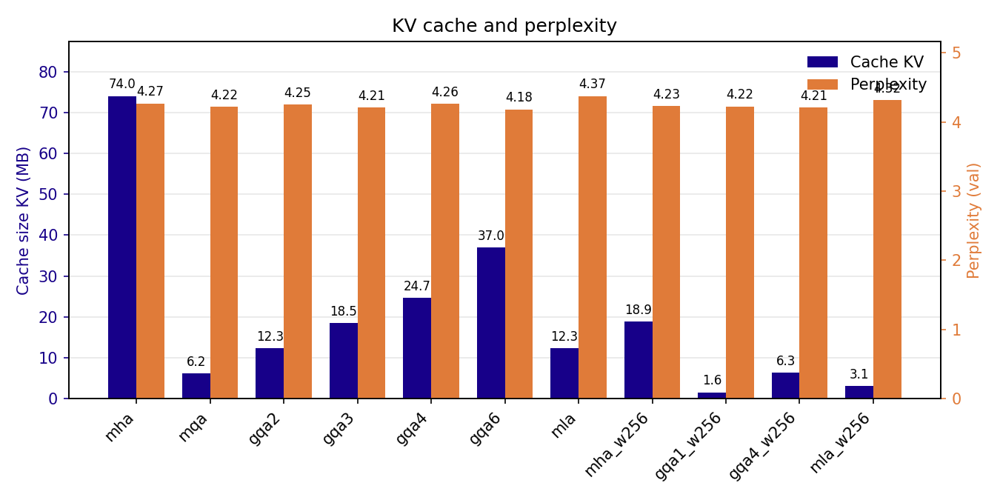

# gpt2-attention-variants

During generation, a transformer keeps the keys and values of every past token in memory (the KV cache). For GPT-2 small at full context, this cache takes 74 MB per sequence in fp32, and it grows linearly with the context length and the batch size. This repository implements GPT-2 small from scratch in PyTorch with several attention mechanisms that shrink this cache, trains each one on TinyStories with the same setup, and measures what each saves in memory and costs in perplexity.

This project started during my summer 2026 internship at Omundu, on compressed attention for small language models.

## Attention variants

| Variant | K/V heads | Values cached per token and per layer | Config |
|---|---|---|---|
| MHA (multi-head) | 12 | 2 × 12 × 64 = 1536 | `attention="mha"` |
| GQA (grouped-query) | g = 2, 3, 4, 6 | 2 × g × 64 | `attention="gqa"`, `n_groups=g` |
| MQA (multi-query) | 1 | 2 × 64 = 128 | `attention="gqa"`, `n_groups=1` |
| MLA (multi-head latent) | 12, rebuilt from a latent | d_latent = 256 | `attention="mla"`, `d_latent=256` |

Two options can be combined with them:

- Sliding window attention (`window_size=W`): each token only attends to the last W tokens, so the cache never holds more than W tokens. Works with all variants.
- Cross-layer attention (`cla_factor=k`): only one layer out of k computes K/V, the next k − 1 layers reuse them, which divides the cache by k. Implemented for MHA and GQA.

In MLA, each token is projected to a 256-dim latent vector, which is the only thing cached. K and V are rebuilt from it with two up-projections. This is a simplified version of DeepSeek-V2's MLA: there is no decoupled RoPE, since the model uses learned absolute position embeddings.

## Results

All models have the GPT-2 small sizes (12 layers, 12 heads, d_model = 768, context 1024). They were trained for one epoch on TinyStories (474M tokens) with the same hyperparameters and seed. Only the attention changes.

| Model | Parameters | KV cache per token (KB) | KV cache after 1004 tokens (MB) | Val. perplexity | Tokens/s |
|---|---|---|---|---|---|
| mha | 163.0M | 73.7 | 74.0 | 4.27 | 44.1 |
| gqa6 | 155.9M | 36.9 | 37.0 | 4.18 | 32.4 |
| gqa4 | 153.6M | 24.6 | 24.7 | 4.26 | 46.9 |
| gqa3 | 152.4M | 18.4 | 18.5 | 4.21 | 52.5 |
| gqa2 | 151.2M | 12.3 | 12.3 | 4.25 | 54.8 |
| mqa | 150.0M | 6.1 | 6.2 | 4.22 | 52.4 |
| mla (d_latent = 256) | 155.9M | 12.3 | 12.3 | 4.37 | 47.1 |
| mha, window 256 | 163.0M | 73.7 | 18.9 | 4.23 | 47.4 |
| gqa4, window 256 | 153.6M | 24.6 | 6.3 | 4.21 | 37.4 |
| mqa, window 256 | 150.0M | 6.1 | 1.6 | 4.22 | 46.2 |
| mla, window 256 | 155.9M | 12.3 | 3.1 | 4.32 | 47.2 |

The KV cache is measured after generating 1000 tokens from a 4-token prompt, in fp32, summed over the 12 layers. With a window of 256, the cache stops growing after 256 tokens. Perplexity is computed on the whole TinyStories validation split. Tokens/s comes from the same generation run (batch size 1, RTX 5060 Ti).



What these numbers show:

- MQA divides the cache by 12 compared to MHA, and GQA2 by 6, for a perplexity in the same range. All MHA, GQA and MQA models are between 4.18 and 4.27. With a single run per model, the order inside that range is not meaningful.
- MLA caches as much as GQA2 but has the highest perplexity (4.37). In this implementation it is not faster either, because K and V are recomputed from the whole latent cache at each step.
- A 256-token window does not increase perplexity here. TinyStories stories are short, so most tokens never need more than 256 tokens of context. This would probably not hold on a dataset with longer documents.
- MQA with a 256-token window needs about 47 times less cache than MHA (1.6 MB vs 74 MB) at a similar perplexity.
- The throughput numbers come from one run each and are noisy (gqa6 is slower than mha, which its cache size does not explain). They should not be read as a ranking. At this model size and batch size 1, the cache size has no clear effect on speed.

## Quick start

Requires Python 3.10 or later. A CUDA GPU is strongly recommended for training.

```
git clone https://github.com/4nath0s/gpt2-attention-variants.git
cd gpt2-attention-variants
pip install -r requirements.txt
```

Download and tokenize TinyStories. This writes `train.bin` (about 950 MB) and `val.bin` next to the scripts:

```
python preprocess.py
```

Choose the variant in `config.py`, for example GQA with 4 groups and a 256-token window:

```python
attention: str = "gqa"
n_groups: int = 4
window_size: int | None = 256
cla_factor: int = 1
```

Train it:

```
python training.py
```

The checkpoint goes to `models/model_and_optimizer_<name>.pth` (here `gqa4_w256`), and the loss curves go to `curves/`. A checkpoint with its optimizer state takes about 2 GB.

To compare trained models, put their names in the `attentions` list at the end of `generation.py`, then run:

```
python generation.py
```

It computes perplexity, generation time, tokens/s and KV cache size for each model, and saves the plots next to the script.

## Configuration

| Field | Default | Meaning |
|---|---|---|
| `attention` | `"gqa"` | `"mha"`, `"gqa"` or `"mla"` |
| `n_groups` | 4 | Number of K/V heads for GQA (1 = MQA, 12 = MHA) |
| `d_latent` | 256 | Size of the cached latent vector for MLA |
| `window_size` | `None` | Sliding window size, `None` = full causal attention |
| `cla_factor` | 1 | Number of layers sharing the same K/V (1 = no sharing) |
| `context_length` | 1024 | Maximum sequence length |
| `d_model`, `n_layers`, `n_heads` | 768, 12, 12 | GPT-2 small sizes |
| `dropout` | 0.1 | Dropout on embeddings, attention weights and residual branches |
| `seed_number` | 123 | Random seed |

## Repository layout

| File | Content |
|---|---|
| `config.py` | Model and run configuration (`GPTConfig`) |
| `preprocess.py` | Downloads and tokenizes TinyStories into `train.bin` / `val.bin` |
| `dataset.py` | Dataset reading the `.bin` files with `np.memmap` |
| `mask.py` | Causal mask, with optional sliding window |
| `mha.py`, `gqa.py`, `mla.py` | Attention modules, each with its KV cache |
| `model.py` | GPT-2 model: embeddings, transformer blocks, output head |
| `training.py` | Training loop, saves the checkpoint and the loss curves |
| `generation.py` | Loads checkpoints, measures perplexity, speed and KV cache, plots the results |

## Implementation notes

- The cache is stored per attention module. During generation, the prompt goes through the model once, then each step only feeds the new token. `GPTModel.current_pos` keeps track of the position embeddings.
- GQA caches only the `n_groups` K/V heads. They are expanded to 12 heads with `repeat_interleave` just before the matrix product, so the expansion never ends up in the cache.
- With a sliding window, the cache is trimmed to the last W tokens. The mask is indexed relative to the start of the cache, which stays correct after trimming because the mask only depends on the distance between query and key.
- The causal mask is a non-persistent buffer, rebuilt from the config when a checkpoint is loaded.

## Training setup

- Data: [TinyStories](https://huggingface.co/datasets/roneneldan/TinyStories), GPT-2 BPE tokenizer (tiktoken)
- 1 epoch (about 116k steps), batches of 4 sequences of 1024 tokens
- AdamW, learning rate 4e-4 (constant), weight decay 0.1
- bf16 autocast, seed 123
- Hardware: one NVIDIA GeForce RTX 5060 Ti (16 GB)
- The output layer is not tied to the token embeddings, which is why MHA has 163M parameters instead of GPT-2's 124M

## Limitations and next steps

- One training run per model, so small perplexity differences are within noise. Several seeds would be needed to rank the GQA variants.
- Positions are learned embeddings, so generation cannot go past 1024 tokens, even with a sliding window. RoPE would remove this limit.
- MLA has no weight absorption at inference, so it saves memory but not compute.
- The KV cache is stored in fp32. A bf16 cache would halve all the sizes above.
- Cross-layer attention is implemented but no model has been trained with it yet.

## References

- Radford et al., 2019. [Language Models are Unsupervised Multitask Learners](https://cdn.openai.com/better-language-models/language_models_are_unsupervised_multitask_learners.pdf) (GPT-2)
- Shazeer, 2019. [Fast Transformer Decoding: One Write-Head is All You Need](https://arxiv.org/abs/1911.02150) (MQA)
- Ainslie et al., 2023. [GQA: Training Generalized Multi-Query Transformer Models from Multi-Head Checkpoints](https://arxiv.org/abs/2305.13245)
- DeepSeek-AI, 2024. [DeepSeek-V2: A Strong, Economical, and Efficient Mixture-of-Experts Language Model](https://arxiv.org/abs/2405.04434) (MLA)
- Beltagy et al., 2020. [Longformer: The Long-Document Transformer](https://arxiv.org/abs/2004.05150) (sliding window attention)
- Brandon et al., 2024. [Reducing Transformer Key-Value Cache Size with Cross-Layer Attention](https://arxiv.org/abs/2405.12981) (CLA)
- Eldan and Li, 2023. [TinyStories: How Small Can Language Models Be and Still Speak Coherent English?](https://arxiv.org/abs/2305.07759)

## Credits

The GPT-2 base code (model, training loop, data loading) follows Sebastian Raschka's book [Build a Large Language Model (From Scratch)](https://github.com/rasbt/LLMs-from-scratch).

## License

MIT, see [LICENSE](LICENSE).
